[Back to README.md](../README.md)

# Tiled Wang Examples

The gallery distinguishes visual layout from terrain topology. The exact
`tileset-layout-wang-mixed` codename means the composed 24×10 scene-sheet
arrangement documented in [Scene Sheet 24x10](art-formats/scene-sheet-24x10/README.md);
it does not mean that an image is a Wang tileset. A **mixed Wang companion** is
a separate TSX whose assignments contain both cardinal-edge and diagonal-corner
values. A gallery entry is classified by the asset it actually contains:
scene-sheet layout, Wang companion, or both. Every packaged map keeps its TSX
and referenced PNG beside it.

| Name | Grid | Classification | Tileset PNG | Sample level PNG |
|---|---|---|---|---|
| [Mossy Retro Dungeon](examples/01-mossy-retro-dungeon/README.md) | 16×16 | scene-sheet layout + mixed Wang companion | <a href="examples/01-mossy-retro-dungeon/output/scene-sheet.png">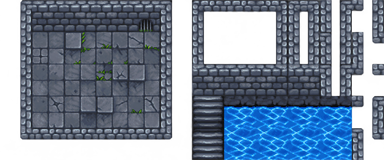</a> | <a href="examples/01-mossy-retro-dungeon/output/preview.png">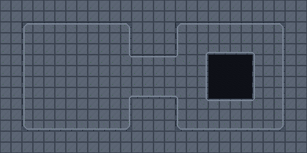</a> |
| [Fenced Forest Clearing](examples/02-fenced-forest-clearing/README.md) | 16×16 | scene-sheet layout + mixed Wang companion | <a href="examples/02-fenced-forest-clearing/output/scene-sheet.png">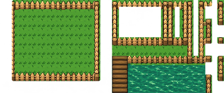</a> | <a href="examples/02-fenced-forest-clearing/output/preview.png">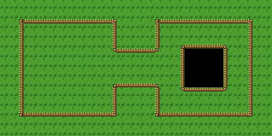</a> |
| [Rainwashed Brick Street](examples/03-rainwashed-brick-street/README.md) | 16×16 | scene-sheet layout + mixed Wang companion | <a href="examples/03-rainwashed-brick-street/output/scene-sheet.png">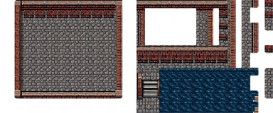</a> | <a href="examples/03-rainwashed-brick-street/output/preview.png">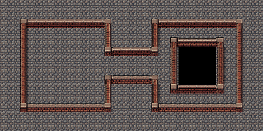</a> |
| [Painted Moss River](examples/04-painted-moss-river/README.md) | 64×64 | scene-sheet layout + mixed Wang companion | <a href="examples/04-painted-moss-river/output/scene-sheet.png">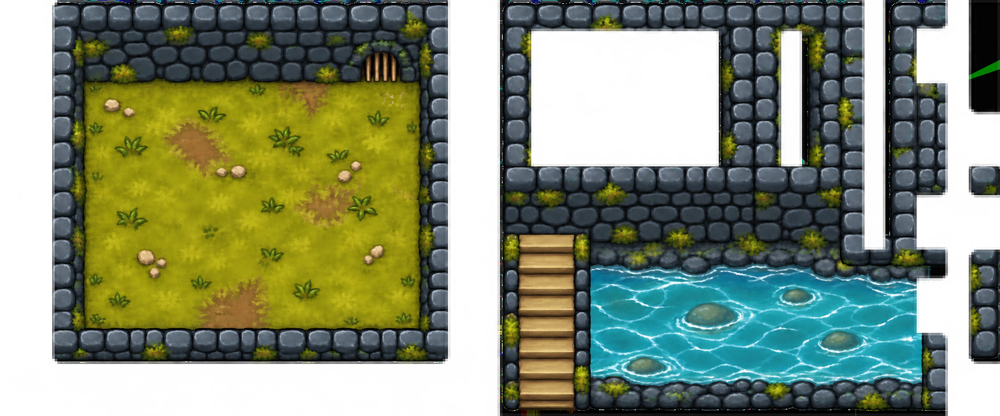</a> | <a href="examples/04-painted-moss-river/output/preview.png">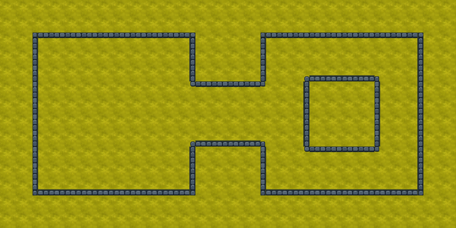</a> |
| [Robotic Coolant Facility](examples/05-robotic-coolant-facility/README.md) | 64×64 | scene-sheet layout + mixed Wang companion | <a href="examples/05-robotic-coolant-facility/output/scene-sheet.png">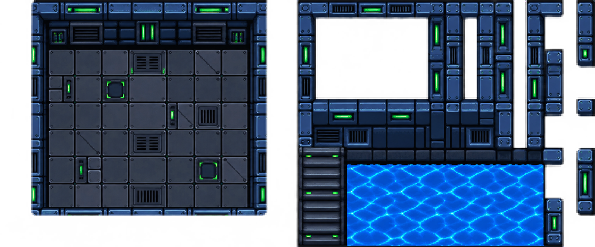</a> | <a href="examples/05-robotic-coolant-facility/output/preview.png">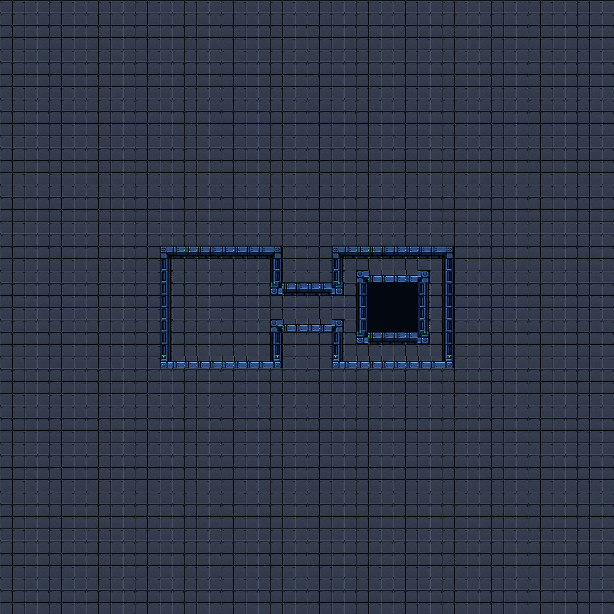</a> |
| [Sunlit Desert Oasis](examples/06-sunlit-desert-oasis/README.md) | 32×32 | generated mixed Wang companion | <a href="examples/06-sunlit-desert-oasis/output/tiles.png">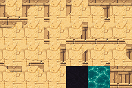</a> | <a href="examples/06-sunlit-desert-oasis/output/preview.png">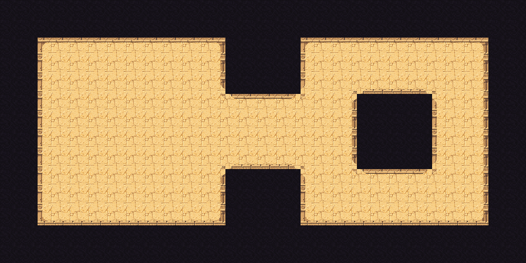</a> |
| [Snowbound Pine Village](examples/07-snowbound-pine-village/README.md) | 32×32 | generated mixed Wang companion | <a href="examples/07-snowbound-pine-village/output/tiles.png">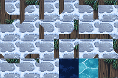</a> | <a href="examples/07-snowbound-pine-village/output/preview.png">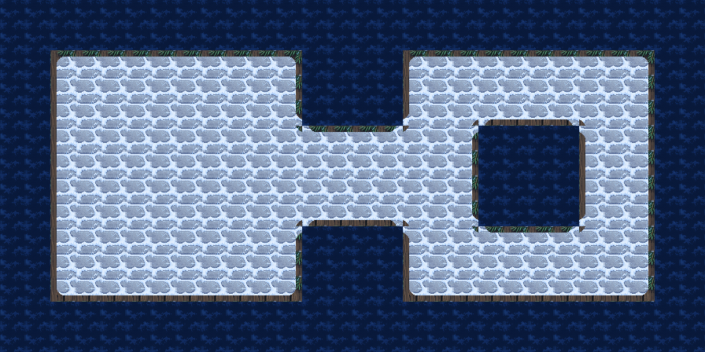</a> |
| [Volcanic Basalt Keep](examples/08-volcanic-basalt-keep/README.md) | 32×32 | generated mixed Wang companion | <a href="examples/08-volcanic-basalt-keep/output/tiles.png">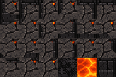</a> | <a href="examples/08-volcanic-basalt-keep/output/preview.png">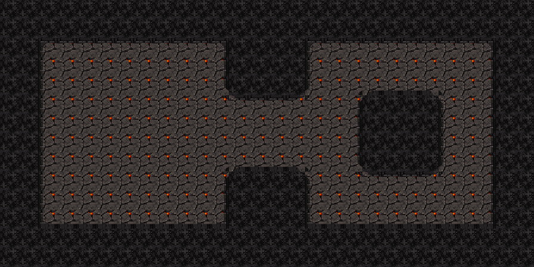</a> |
| [Coral Sunken Temple](examples/09-coral-sunken-temple/README.md) | 32×32 | generated mixed Wang companion | <a href="examples/09-coral-sunken-temple/output/tiles.png">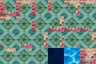</a> | <a href="examples/09-coral-sunken-temple/output/preview.png">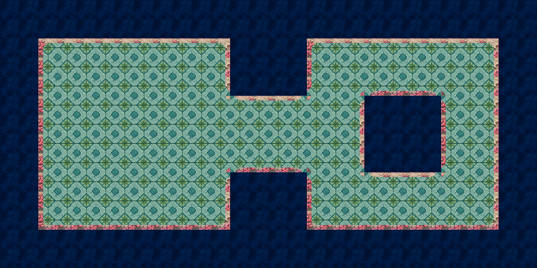</a> |
| [Indigo Crystal Dungeon](examples/10-indigo-crystal-dungeon/README.md) | 64×64 | scene-sheet layout + mixed Wang companion | <a href="examples/10-indigo-crystal-dungeon/output/scene-sheet.png">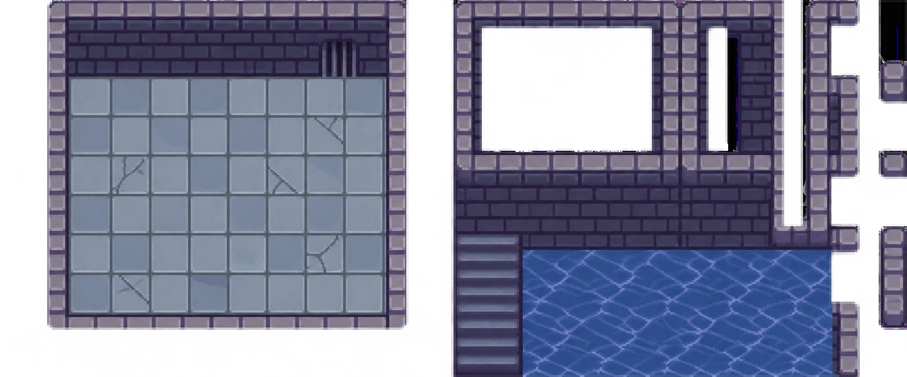</a> | <a href="examples/10-indigo-crystal-dungeon/output/preview.png">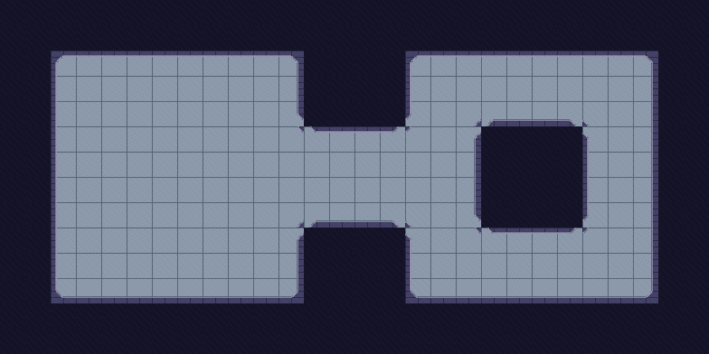</a> |

## Prompts

Each example page contains its full prompt and source notes. The layout reference is included as [layout-reference.png](examples/layout-reference.png).

## Verification scope

The 16×16 Retro Dungeon, Forest, and Street Wang sources and the 64×64 Painted Moss River and Indigo Dungeon sources had live Figure 8 terrain checks in their original sessions. The 64×64 Robot Wang source had a live check in its original session. The 32×32 companion maps were assembled from generated swatches and inspected in Tiled; they were not live terrain-painted. Each packaged map was generated or copied with local TSX and PNG references. A scene sheet alone is not a Wang tileset.
